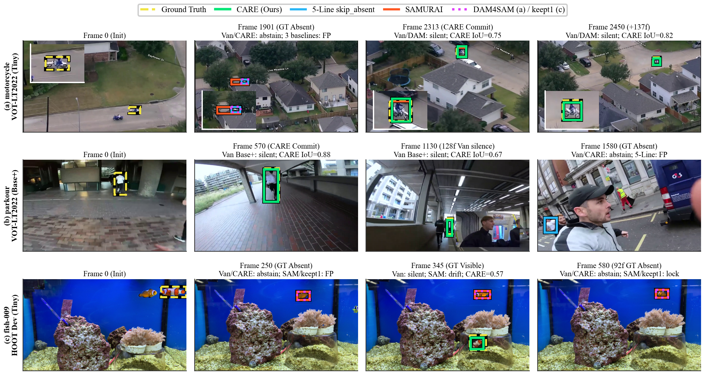

# CARE-SAM2: Diagnosing and Controlling Empty-Mask Spatial Memory Inertia in SAM 2 for Long-Term Visual Object Tracking

**Authors:** Zhaoyang Liang (`lzy340579@gmail.com`) and Qiang Fu  
**Affiliation:** School of Information and Communication, Guilin University of Electronic Technology, Guilin 541004, China

Official code, counterfactual probes, and audited benchmark reproduction suite for our manuscript:
*Diagnosing and Controlling Empty-Mask Spatial Memory Inertia in SAM 2 for Long-Term Visual Object Tracking*.

## Overview

Vanilla SAM 2.1 often remains silent (`object_score_logits <= 0`) for tens or hundreds of visible frames after target disappearance or transient misses. Across all 50 sequences of VOT-LT2022 (168,232 post-initialization frames; 168,282 total frames), visible-frame silence affects 34/50 videos (68.0%) and 22,900/151,499 post-initialization visible frames (15.1%), including 69/176 qualifying reappearance windows (67/176 silent at `t0`). This repository accompanies our three core findings:

1. **Causal isolation of empty-mask spatial memory inertia:** Using a nine-arm counterfactual probe on identical cached image features (`0.0000` mirror logit difference across 22,900 silent-visible and 13,504 silent-absent frames in VOT-LT2022) plus a dedicated verified-empty `2x2` single-slot factorial control (`run_a3_single_slot_control.py`, `s_obj^{(t-1)} <= 0`), we isolate empty-mask spatial memory maps rather than `no_obj_ptr` tokens or `no_obj_embed_spatial` as the primary suppressor.
2. **Pareto trade-offs, cross-backbone scaling, and threshold masking:** Vanilla `Base+` accumulates more visible silence than `Tiny` (33,217 vs. 22,900 frames) and drops below `Tiny` in online Macro F1 (0.5309 vs. 0.5388; 76/176 vs. 87/176 timely recoveries). Five-line absent-skipping restores recall, but adds +2,252 (+69.7%) absent false positives on Tiny and +3,600 (+125.9%) on Base+; on the identical `vot-toolkit 0.9.0` evaluator, post-hoc sweeping at `best_th` (`0.8640` and `0.9957`) masks 31.1% (1,706) and 53.1% (3,427) of those absent false positives, compared with 0 (0.0%) on CARE Tiny (`-inf`).
3. **CARE controller:** A training-free, zero-external-model controller (`sam2_native`) combining certified dual-anchor probing (`M_0 + M_clean`), cached FPN appearance verification (outperforming external DINOv2 ViT-S/14 on all 50 VOT-LT2022 sequences by `+0.0063` online F1 and `-2,760` absent FPs), boundary-adjusted scale normalization, and one-step self-verification rollback.

## Main VOT-LT2022 Results (50 Sequences, 168,232 Post-Init / 168,282 Total Frames, 176 Qualifying Events)

All values below are parsed programmatically from audited `independent-audit.json` files (see [results/CLOUD_SUMMARY_REPORT.md](results/CLOUD_SUMMARY_REPORT.md) for component ablations, 10,000-resample paired bootstrap 95% confidence intervals, and full counterfactual breakdowns). `Med ms` denotes post-decode synchronized median step latency (P95: Tiny vanilla/CARE `107.6 -> 197.9 ms`, Base+ vanilla/CARE `163.2 -> 241.5 ms`).

| Configuration | Timely (/176) | First (/176) | Absent FP | Vis. IoU | Online P | Online R | Online F1 | VOT-tk F (`vot-toolkit 0.9.0`) | `best_th` | Med ms |
| :--- | :---: | :---: | :---: | :---: | :---: | :---: | :---: | :---: | :---: | :---: |
| SAM 2.1 Tiny (`vanilla`) | 87 | 81 | 3,229 | 0.5145 | 0.5750 | 0.5068 | **0.5388** | **0.5413** | `-inf` | 94.4 |
| SAM 2.1 Tiny (`gate_skip_absent`, 5-line) | 114 | 99 | 5,481 | 0.5589 | 0.5378 | 0.5472 | **0.5425** | **0.5472** | `0.8640` | 114.4 |
| SAM 2.1 Tiny (`gate_skip_absent_keept1`) | 113 | 96 | 7,774 | 0.5638 | 0.5464 | 0.5585 | **0.5524** | **0.5570** | `0.8854` | 114.0 |
| SAMURAI Tiny (stock, `min_obj=-1.0`) | 113 | 96 | 9,856 | 0.5682 | 0.5324 | 0.5549 | **0.5434** | **0.5510** | `0.8056` | 190.4 |
| SAMURAI Tiny (calibrated, `min_obj=0.0`) | 115 | 101 | 6,411 | 0.5712 | 0.5480 | 0.5598 | **0.5539** | **0.5588** | `0.8328` | 187.7 |
| DAM4SAM Tiny (det. fixed box) | 101 | 82 | 6,044 | 0.5308 | 0.5188 | 0.5227 | **0.5207** | **0.5262** | `0.9619` | 132.1 |
| **CARE Tiny (`sam2_native`)** | 96 | 89 | 3,763 | 0.5671 | 0.5709 | 0.5518 | **0.5612** | **0.5638** | `-inf` | **93.5** |
| SAM 2.1 Base+ (`vanilla`) | 76 | 66 | 2,859 | 0.4886 | 0.5836 | 0.4869 | **0.5309** | **0.5349** | `0.9097` | 147.3 |
| SAM 2.1 Base+ (`gate_skip_absent`, 5-line) | 115 | 102 | 6,459 | 0.5586 | 0.5414 | 0.5499 | **0.5456** | **0.5530** | `0.9957` | 161.6 |
| SAM 2.1 Base+ (`gate_skip_absent_keept1`) | 101 | 90 | 6,056 | 0.5206 | 0.5370 | 0.5218 | **0.5293** | **0.5345** | `0.9786` | 161.3 |
| **CARE Base+ (`sam2_native`)** | 100 | 88 | 3,142 | 0.5671 | 0.5839 | 0.5583 | **0.5708** | **0.5750** | `0.9232` | **143.0** |

## Counterfactual Decomposition & Verified-Empty Single-Slot Factorial Control

- `drop_recent_ptrs_keep_spatial` (VOT-LT2022, 34/50 affected videos, 69/176 silent reappearance windows): recovers **62/22,900** silent-visible frames (0.3%, 1/69 events, video-macro 3.34%).
- `drop_recent_spatial_keep_ptrs`: recovers **8,472/22,900** silent-visible frames (37.0%, 30/69 events, video-macro 35.74%).
- `m0_only` vs. `m0_plus_1empty`: appending the `t-1` slot (spatial map + pointer) reduces visible recovery by 84.3%, from **7,134/22,900** (25/69 events) to **1,123/22,900** (5/69 events).
- **Verified-empty `2x2` single-slot factorial control** (`run_a3_single_slot_control.py`, `s_obj^{(t-1)} <= 0`, `k_t >= 2`): adding only the `t-1` `no_obj_ptr` increases recovery from **316/572** to **337/572** (3/7 events) on the 5 local VOT-LT2022 blind sequences and from **173/511** to **189/511** (3/7 events) on HOOT Dev, whereas adding only the `t-1` empty spatial map (pointers fixed at `p_0`) cuts recovery by **99.7%** to **1/572** (0/7 events) on VOT-LT2022 and by **95.4%** to **8/511** (0/7 events) on HOOT Dev.
- `m0_plus_mclean` (CARE `1+1` dual anchor): recovers **7,460/22,900** frames (32.6%, 32/69 events; video-macro 27.31% vs. 29.57% for `m0_only`) while cutting absent false activations from **2,439/13,504** (18.1% under `m0_only`) and **2,640/13,504** (19.5% under `m0_plus_6vis_condptr`) down to **1,609/13,504** (11.9%).

## Qualitative Closed-Loop Tracking & Absence-Abstention Comparisons



## Repository Structure

```text
CARE-SAM2/
├── research/longterm_recovery/
│   ├── care_sam2_plugin.py                    # Core CARE controller, host adapters, verifier, and runner
│   ├── audit_care_sam2_plugin.py              # Independent trace & vot-toolkit 0.9.0 auditor
│   ├── run_memory_gating_benchmark.py         # Sharded 5-line absent-skipping & keept1 benchmark runner
│   ├── run_counterfactual_inertia_benchmark.py# Sharded 9-arm counterfactual decomposition runner
│   ├── run_a3_single_slot_control.py          # Verified-empty 2x2 single-slot factorial control runner
│   ├── summarize_cloud_results.py             # Programmatic table & 10,000-resample bootstrap CI aggregator
│   ├── gonogo_a6_decomposed.py                # 9-arm counterfactual memory patch definitions
│   ├── gonogo_simple_gating.py                # Gating policy hooks and dataset loader extensions
│   ├── cloud/
│   │   ├── setup_autodl.sh                    # Dependency, checkpoint, and host repo setup
│   │   ├── download_benchmarks.sh             # Official VOT-LT2022 (50 seqs) & LaSOT-ext verifier
│   │   └── run_full_suite.sh                  # Full sharded evaluation matrix runner
│   └── ...                                    # Minimal metric, boundary, and calibration helpers
├── tests/
│   ├── test_care_sam2_plugin.py               # Unit tests for controller, rollback, verifier, and auditor
│   └── test_cloud_positioning_runners.py      # Unit tests for gating, counterfactual aggregation, and CIs
├── results/
│   ├── CLOUD_SUMMARY_REPORT.md                # Full audited VOT-LT2022 summary & 50-seq ablations (incl. DINOv2)
│   ├── cloud_trajectory_audit_20261124.json   # Same-evaluator vot-toolkit 0.9.0 tau=-inf vs tau* & A2/A3/A4 audit
│   ├── fig_pareto_frontier.png                # Same-evaluator Pareto frontier (Tiny & Base+)
│   └── fig_qualitative_cases.png              # Audited 3x4 qualitative comparisons (VOT-LT2022 & HOOT Dev)
├── requirements.txt
└── LICENSE
```

## Frozen Provenance

All cloud and local main results were executed with the frozen `care_sam2_plugin.py` script:

- File: `research/longterm_recovery/care_sam2_plugin.py`
- SHA-256: `040111494465accf974092b3a7fefc496a52fad8b9071d31df1de3a0396e7ca0`

## Installation & Unit Tests

```bash
pip install -r requirements.txt
python -m unittest discover -s tests -v
```

Note: If you have a local `vot-toolkit` Python source checkout instead of a PyPI installation, set `VOT_TOOLKIT_PYTHON=/path/to/vot-toolkit/python` before running tests.

## Reproducing the Full VOT-LT2022 Benchmark Suite

1. **Install checkpoints and clone official host repositories** (`facebookresearch/sam2`, `yangchris11/samurai`, `jovanavidenovic/DAM4SAM`):

```bash
bash research/longterm_recovery/cloud/setup_autodl.sh
```

2. **Download and verify official VOT-LT2022 (50 sequences, 168,282 frames):**

```bash
bash research/longterm_recovery/cloud/download_benchmarks.sh --vot-only
```

3. **Run the sharded evaluation matrix and counterfactual probes:**

```bash
bash research/longterm_recovery/cloud/run_full_suite.sh --vot-only
```

4. **Aggregate audited outputs and compute 10,000-resample paired bootstrap CIs:**

```bash
python research/longterm_recovery/summarize_cloud_results.py \
  --runs-dir /root/autodl-tmp/care_eval/runs \
  --output-md results/CLOUD_SUMMARY_REPORT.md
```

## Citation

If you find this diagnosis or CARE controller useful in your research, please cite:

```bibtex
@article{liang2026care,
  author  = {Liang, Zhaoyang and Fu, Qiang},
  title   = {Diagnosing and Controlling Empty-Mask Spatial Memory Inertia in SAM 2 for Long-Term Visual Object Tracking},
  year    = {2026}
}
```
